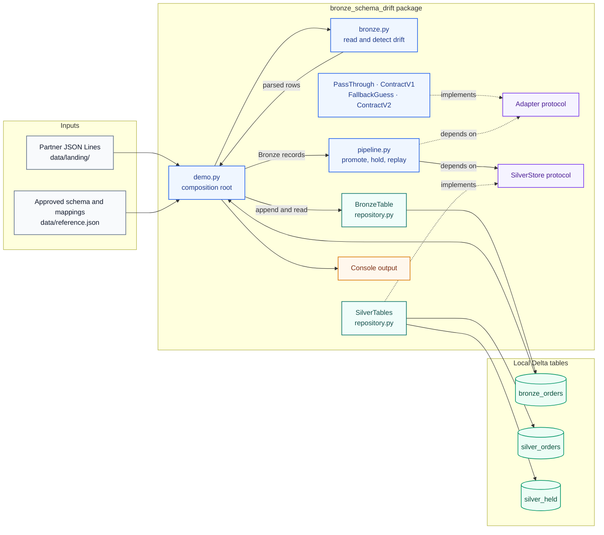

# A renamed source field between Bronze and Silver

## What this demo does

It runs the article's example on local Delta Lake tables. Three partner files land in Bronze through a reader that mimics Auto Loader's rescue mode. The old Silver step succeeds with empty customer codes. The demo then finds the change record by record, holds what a Silver contract cannot vouch for, shows a fallback hiding a conflict, and replays the held records through an approved adapter, twice.

This uses the open-source `deltalake` library (delta-rs) on local disk. It is not a Databricks runtime and does not run Auto Loader.

## Prerequisites

- Python 3.10+ on macOS or Linux
- Network access for the initial dependency installation

## Run locally

```bash
./run_demo.sh
```

The script creates a project-local `.venv` if needed, installs the project and its
development dependencies from `pyproject.toml`, runs the test suite, and then runs
the demo. The demo writes its Delta tables to `lake/`; it resets its own output
tables on each run. The `.gitignore` excludes the environment, caches, and
generated tables from Git.

## Architecture



`demo.py` wires the flow. Bronze preserves landed records; the pipeline applies
an adapter through the `Adapter` protocol and uses the `SilverStore` abstraction
to write valid and held records. Replay reads Bronze again and runs held records
through the approved adapter.

## Sample output

Recorded on Python 3.12 with `deltalake` 1.6.6. Test duration varies by machine.

```text
...........                                                              [100%]
11 passed in 1.02s
deltalake 1.6.6 on local disk; not a Databricks runtime; reader mimics rescue mode
1. Bronze: {'records': 8, 'with_rescued_data': 4}. Rescued for o4: {"account_code": "A-72", "_file_path": "orders_0602.json"}
2. Old Silver step succeeded: {'rows': 8, 'customer_code_null': 3, 'amount_null': 1, 'join_matches': 5}
3. Drift by file (file, added, missing, record shapes): [('orders_0601.json', [], [], 1), ('orders_0602.json', ['account_code'], ['customer_code'], 1), ('orders_0603.json', ['account_code'], [], 2)]
4. Contract v1: valid ['o1', 'o2', 'o3', 'o7']; coverage {'landed': 8, 'valid': 4, 'held': 4, 'unaccounted': []}
   held ('o4', 'unapproved key field in rescued data: account_code; customer_code missing')
   held ('o5', 'unapproved key field in rescued data: account_code; customer_code missing; amount did not parse')
   held ('o6', 'unapproved key field in rescued data: account_code; customer_code missing')
   held ('o8', 'unapproved key field in rescued data: account_code')
5. Fallback guess for o8: {'fallback_says': 'C-1', 'account_A72_means': 'C-4'}
6. Replay through v2: released ['o4', 'o5', 'o6']; still held [('o8', 'customer_code C-1 and account A-72 (C-4) disagree')]; Silver rows 7, join matches 7
   Second identical replay: Silver rows 7
7. Matches a fresh run of the same Bronze through v2: True
```

## What each step stands for

| Step | In the article |
|------|----------------|
| 1 | "Keep the source, with its details": rescue-style landing. |
| 2 | "Why the load passed": the old Silver step. |
| 3 | "Compare each record with the approved schema". |
| 4 | "Let Silver hold what it cannot vouch for": contract v1, reasons, coverage. |
| 5 | "A rename needs the source owner, not a fallback". |
| 6, 7 | "Replay through the same adapter": v2, a second replay, a fresh-run comparison. |

## Layout

| Path | Purpose |
|------|---------|
| `data/` | Synthetic partner files and reference data |
| `src/bronze_schema_drift/` | Installable Python package |
| `src/bronze_schema_drift/protocols.py` | `Adapter` and `SilverStore` interfaces |
| `src/bronze_schema_drift/models.py` | Columns and frozen value objects |
| `src/bronze_schema_drift/bronze.py` | Rescue-style landing and record-level drift detection |
| `src/bronze_schema_drift/adapters.py` | Pass-through, contract v1, fallback guess, contract v2 |
| `src/bronze_schema_drift/pipeline.py` | Promote, hold, replay, reconcile |
| `src/bronze_schema_drift/repository.py` | Bronze, Silver and held records as Delta tables |
| `src/bronze_schema_drift/demo.py` | Composition root: wires the pieces and prints the observed results |
| `tests/` | Tests that lock the results the article quotes and cover batch replay behavior |
| `lake/` | Generated local Delta tables; excluded from Git |
| `pyproject.toml` | Package metadata, dependencies, and pytest configuration |
| `requirements.txt` | Editable install of the project and its development dependencies |
| `run_demo.sh` | Creates the environment, installs dependencies, tests, and runs the demo |
| `.gitignore` | Excludes local environments, caches, and generated files |

## Databricks

No notebook is included. The article links the Databricks pages for Auto Loader schema evolution and Delta schema updates. Behavior on a Databricks runtime was not tested; in particular, Auto Loader also rescues type and case mismatches, which this demo does not model.

## Sources

S347, S348 in the article ledger.
